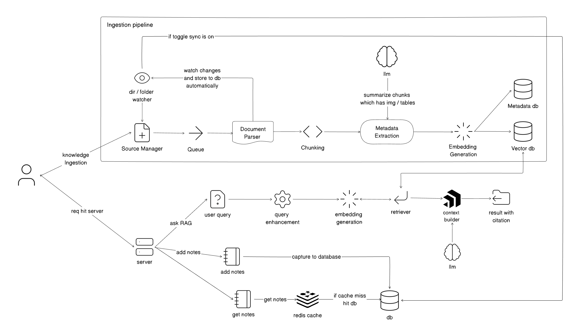

# DocPilot

**Ask your documents — not the open web.**

DocPilot is a personal RAG assistant: upload notes and files, index them, then ask questions from a web app or a floating desktop widget. Answers are grounded in *your* library, with sources you can check.

Built end to end as a solo project — product UI, API, retrieval pipeline, Electron widget, and offline eval.

---

## Why it exists

Study and work files pile up across PDFs, notes, and exports. Keyword search is brittle, and generic chatbots do not know your material.

DocPilot keeps a private knowledge base per user, retrieves the relevant chunks, and generates answers only from that context.

---

## How it works

```text
Upload / notes  →  chunk + embed  →  FAISS (per user)
                                           │
Ask a question  ───────────────────────────┘
                                           ▼
                              retrieve top-k chunks
                                           ▼
                              Groq generates answer
                                           ▼
                              cite sources in the UI
```

1. **Ingest** — PDF, Word, Excel, CSV, TXT, MD (and notes) are chunked and embedded with Sentence Transformers.
2. **Store** — Vectors live in a per-user FAISS index; metadata and auth live in MongoDB.
3. **Retrieve** — A question is embedded and matched against that user’s index.
4. **Generate** — Groq answers from the retrieved chunks only (not general web search by default).
5. **Surface** — Use the web chat or the always-on-top desktop widget; widget look/behavior is controlled from `/widget` on the site.

---

## Features

| Area | What you get |
| --- | --- |
| Auth | Signup / login, JWT, per-user data isolation |
| Knowledge | Multi-format upload + library management |
| Notes | Markdown notes indexed alongside documents |
| Chat | RAG Q&A with source citations |
| Desktop | Electron floating widget (theme, position, opacity, sync) |
| Eval | Offline retrieval metrics on a golden set |

---

## Stack

| Layer | Tech |
| --- | --- |
| Frontend | React, TanStack Router, Vite, TypeScript, Tailwind |
| Backend | FastAPI, MongoDB, JWT |
| RAG | `all-MiniLM-L6-v2`, FAISS (`IndexFlatL2`), Groq |
| Desktop | Electron + React |
| CI | GitHub Actions (smoke tests on `main`) |

---

## Architecture



Widget settings are polled from the same JWT API as the website — no WebSockets, no cross-app login handoff.

---

## Project layout

```text
frontend/     Dashboard, chat, knowledge, notes, widget settings
backend/      API, ingestion, search, eval harness
desktop/      Floating always-on-top widget
```

---

## Run locally

**Prerequisites:** Python 3.11+, Node 18+, MongoDB (or Atlas), a Groq API key.

**1. Backend**

```bash
cd backend
python -m venv venv
source venv/bin/activate   # Windows: venv\Scripts\activate
pip install -r requirements.txt
cp .env.example .env       # fill in MONGO_URL, GROQ_API_KEY, JWT_SECRET
uvicorn main:app --reload
```

**2. Frontend**

```bash
cd frontend
npm install
npm run dev
```

**3. Desktop widget** (optional)

```bash
cd desktop
npm install
npm run dev
```

Then open `/widget` in the web app, turn the widget on, and sign in inside Electron with the same account.

---

## Tests & CI

Simple smoke tests (resume-level, not a full suite):

```bash
# Backend
cd backend && pytest tests/test_smoke.py -q

# Frontend
cd frontend && npm test
```

On every push and PR to `main`, GitHub Actions runs those tests (`.github/workflows/ci.yml`).

---

## Retrieval eval

Golden questions live in `backend/eval/golden.json`. Run against a user’s FAISS store:

```bash
cd backend
source venv/bin/activate
python -m eval.run --user-id <user_id> --dataset eval/golden.json
```

Useful flags: `--k 5`, `--label-mode file|paragraph`, `--generate` (answer quality; uses Groq), `--compare`.

Reports land in `backend/eval/reports/` (Recall@k, Hit@k, Precision@k, F1@k, MRR).

---

## What I focused on

- End-to-end ownership: auth → ingest → retrieve → generate → UI → desktop
- Grounded answers with citations, not a thin ChatGPT wrapper
- Measuring retrieval quality instead of only “it feels right”
- A settings-driven widget that stays in sync without a complex realtime stack
- Lightweight CI so main stays green

---

## Built by

Solo project — design, backend, frontend, desktop widget, and eval pipeline.
